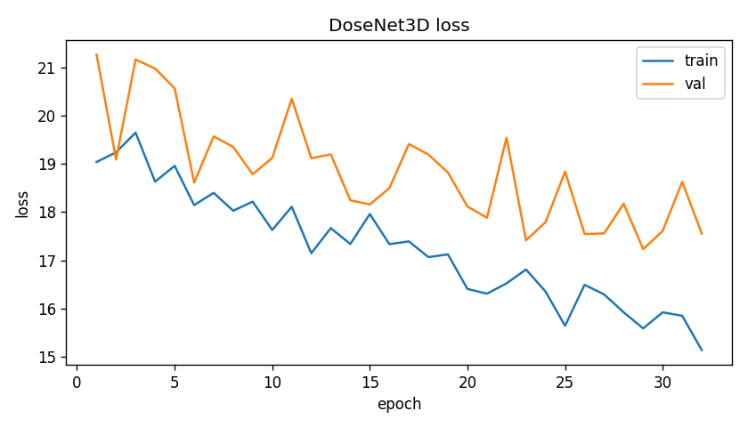

# DoseNet3D: 3D radiotherapy dose prediction

[](https://github.com/krank-09/dosenet3d/actions/workflows/tests.yml)

A 3D U-Net-style network that predicts the full radiation dose (in Gy, at every voxel) for a head-and-neck cancer patient from their CT and contours. I implemented the architecture from Liu et al. (Med. Biol. Eng. Comput. 2025) from scratch in PyTorch and trained it on the public GDP-HMM dataset. Its companion [dvhnet](https://github.com/krank-09/dvhnet) predicts per-organ DVH curves instead; both are part of [rt-dose-prediction](https://github.com/krank-09/rt-dose-prediction).

Research code for learning. Not for clinical use.

## Architecture

```
input [B, 3, 256, 256, 80]: CT, PTV mask, organ label map
  encoder: 3 x (3D strided conv + residual squeeze-and-excitation)
  decoder: upsample + skip connection + 2D deformable convs applied per slice
  head:    1x1x1 conv + ReLU -> dose [B, 1, 256, 256, 80]
```

- The encoder uses 3D convolutions to see across slices. The decoder uses 2D deformable convolutions per slice, because slice spacing is much larger than pixel spacing and the kernels can bend around organ edges.
- InstanceNorm instead of BatchNorm, since 3D volumes only fit a batch size of 1–2.
- About 0.98M parameters, small enough to train on a free 16 GB GPU.
- Loss: voxel L1, plus a gradient term so dose edges stay sharp, plus extra weight inside the tumour (x3) and critical organs (x5 for spinal cord and brainstem).

## Results

50 held-out test patients, whole-volume voxel mean absolute error:

| Training session | Epochs | Test voxel MAE |
|---|---|---|
| 1 (Colab, hit session limit) | 19 | 2.60 ± 0.91 Gy |
| 2 (Kaggle GPU, resumed) | 45 | 1.98 ± 1.06 Gy |
| 3 (Kaggle T4, resumed) | 32 | 1.42 ± 0.82 Gy |



All of the improvement came from more training; the model didn't change. Validation loss was still falling when the last session ended.

While doing this I found a bug: `--resume` only restored the model weights, not the optimizer or learning-rate schedule. Each resumed session restarted its learning-rate schedule from the top, which showed up as a jump in validation loss (18.0 to 27.8). Checkpoints now save the full training state.

For context, the challenge's MedNeXt baseline reports 3.45 Gy on its test set. It uses a different cohort (head-and-neck plus lung) and a masked MAE, so the numbers aren't directly comparable.

## Running it

```bash
python -m venv .venv && source .venv/bin/activate
pip install -r requirements-dev.txt
pytest -q                 # synthetic data only, a few seconds
python model.py           # one full-size forward pass on a fake patient
```

Training needs the GDP-HMM data, which isn't included. Request access on [Hugging Face](https://huggingface.co/datasets/Jungle15/GDP-HMM_Challenge) (CC BY-NC-SA 4.0) and copy `meta_files/` from the [challenge repo](https://github.com/RiqiangGao/GDP-HMM_AAPMChallenge). Then, on a CUDA GPU:

```bash
python train.py --data_root /path/to/GDP-HMM --data_splits_json splits/data_splits_reduced180.json \
    --epochs 300 --batch_size 1 --out_dir runs/dosenet3d
# continue after a session limit:
python train.py --data_root /path/to/GDP-HMM --resume runs/dosenet3d/dosenet3d_best.pt --epochs 300 --out_dir runs/dosenet3d
```

## Layout

```
model.py            the network
losses.py           voxel, gradient and region-weighted losses
data_pipeline.py    CT windowing, masks, resampling, cropping
pipeline_adapter.py GDP-HMM .npz files to model tensors
train.py            training with mixed precision, augmentation and full-state resume
evaluate.py         voxel MAE and per-organ DVH metrics
synthetic_data.py   fake patients for tests and CI
tests/              pytest
```

## Next steps

- I trained on 180 of the 399 training patients to fit free GPU limits. Using all of them, and training longer, is the obvious next step.
- `evaluate.py` already computes per-organ DVH metrics for each patient, but they aren't summarised across the test set yet.

## Credits

- Method: Y. Liu et al. *Deformable dose prediction network based on hybrid 2D and 3D convolution for nasopharyngeal carcinoma radiotherapy.* Med. Biol. Eng. Comput. 63(3), 2025. [doi:10.1007/s11517-024-03231-8](https://doi.org/10.1007/s11517-024-03231-8)
- Data: R. Gao et al. *Automating RT Planning at Scale: High Quality Data For AI Training.* arXiv:2501.11803, 2025 (GDP-HMM, CC BY-NC-SA 4.0).
- Deformable convolutions: Zhu et al., CVPR 2019. Squeeze-and-excitation: Hu et al., CVPR 2018.

Code: MIT.
